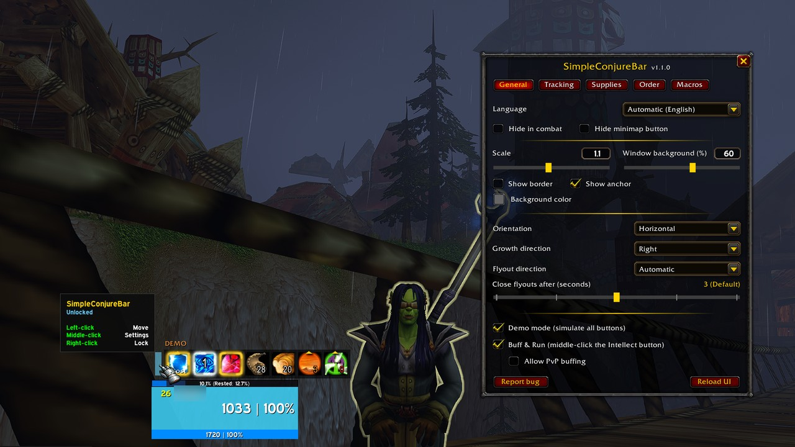
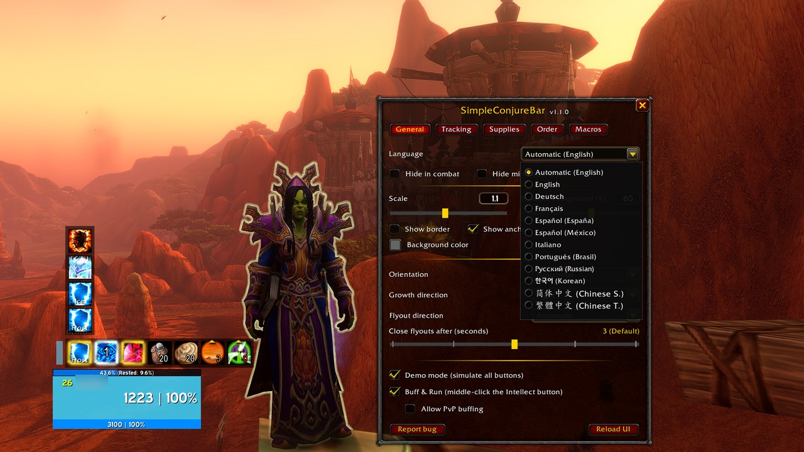
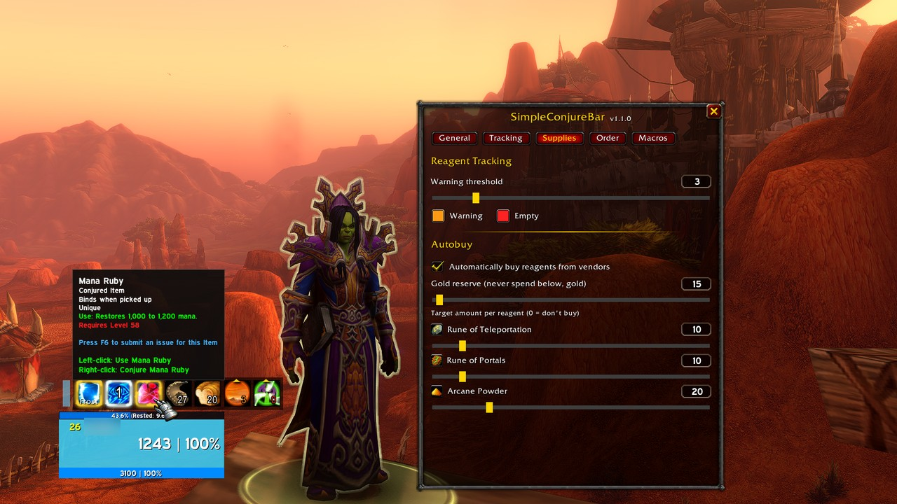
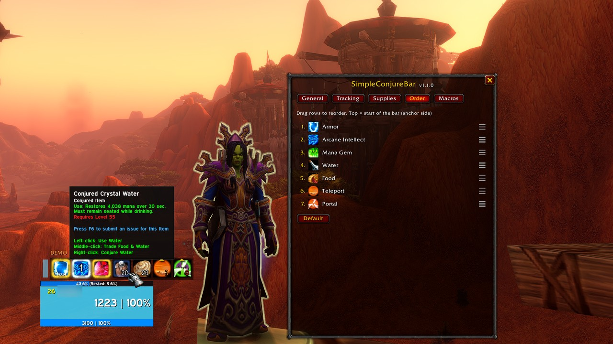
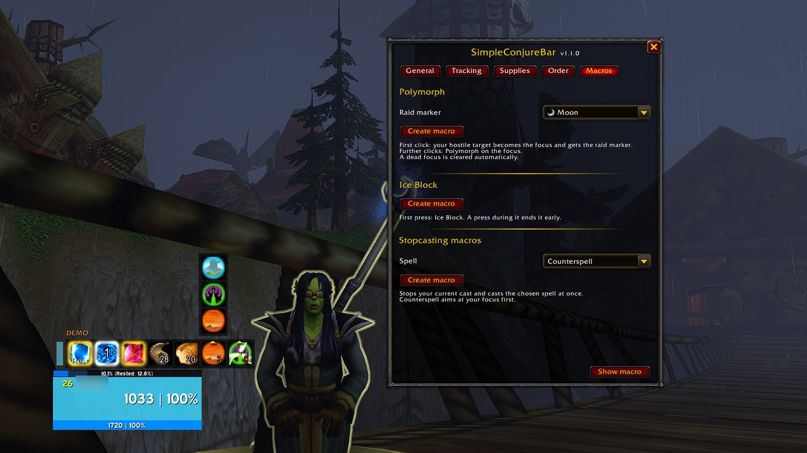
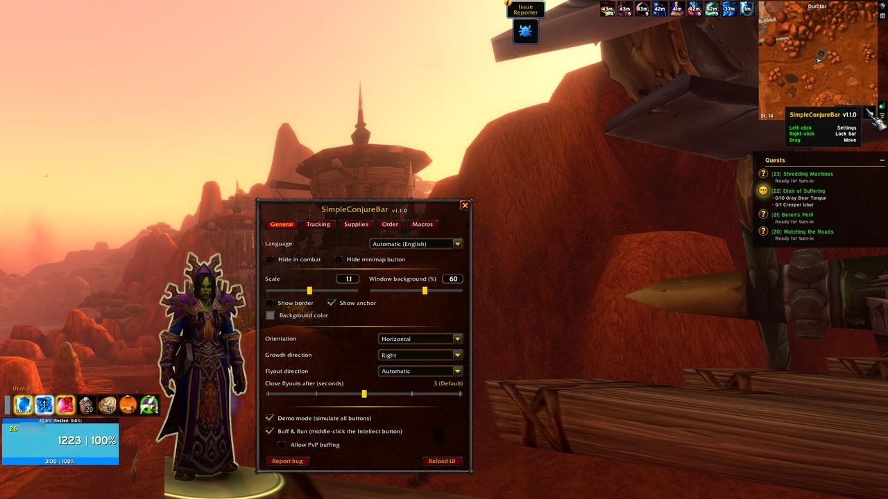
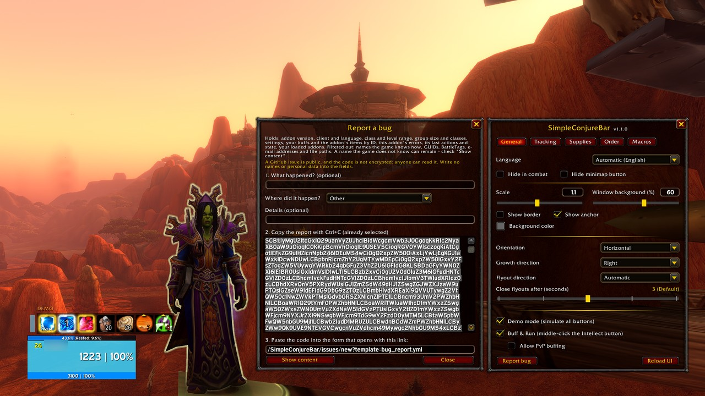

# SimpleConjureBar

A slim mage bar for **WoW Forever** (Classic content on the modern Retail client, Interface 16001).
It bundles everything a mage conjures, buffs and travels with into one movable bar.

## Installation

SimpleConjureBar is published on
[CurseForge](https://www.curseforge.com/wow/addons/simpleconjurebar),
[Wago](https://addons.wago.io/addons/simpleconjurebar) and
[GitHub](https://github.com/ZulshiBLN/SimpleConjureBar/releases) - the same files on all three.

**With WowUp** (2.24 or later, which knows WoW Forever): choose your WoW Forever installation,
then *Get Addons* and search for **SimpleConjureBar**. If the search does not find it yet, use
*Install from URL* with `https://github.com/ZulshiBLN/SimpleConjureBar`. WowUp offers every later
release as an update.

**With the CurseForge or Wago app:** search for SimpleConjureBar in your WoW Forever installation.

**By hand:** download `SimpleConjureBar-<version>-forever.zip` from the
[releases](https://github.com/ZulshiBLN/SimpleConjureBar/releases) and unpack it into
`Interface\AddOns` of your WoW Forever installation, so that the folder
`Interface\AddOns\SimpleConjureBar` holds `SimpleConjureBar.toc`.

The addon loads for mages only.

## Buttons

| Button | Left click | Right click | Middle click |
|---|---|---|---|
| Armor | Cast the last armor | Open the armor flyout (choice is remembered) | – |
| Arcane Intellect | The recommended buff: Arcane Brilliance from the threshold, else the single buff | In a group: open the Brilliance threshold | Buff & Run |
| Mana Gem | Use the best gem (none without a gem) | Conjure the highest missing gem (none with every gem) | – |
| Water / Food | Consume the best item (none without one) | Conjure (rank fitting a targeted player) | Trade water & food to the target |
| Teleport / Portal | Last destination | Open the destinations (choice is remembered) | – |
| Handle | Move the bar | Lock / unlock | Open the settings |

A click with nothing to do has no action and no line in the tooltip. The armor's line names the
armor the left click casts.

- **Arcane Intellect** never buffs your current target: solo it always targets you, in a group
  only mana users in range count and are buffed. A member needs it who has none, then one with a
  weaker rank than yours for his level, then one whose buff runs out within its renew time
  (Tracking tab, 5 minutes by default). The left click casts one recommendation: Arcane Brilliance
  once enough are in need in range - the Brilliance threshold, 3 by default; in a party all of
  them, in a raid those of one subgroup who have none or a weaker one - else the single buff on
  the first in need. Without Brilliance, Arcane Powder or with the threshold at "never" it is
  always the single buff. In a group the right click opens the threshold on the Tracking tab;
  solo it does nothing. The button is locked and greyed out in combat.
  The number on the button shows how many need the buff in range; the tooltip names the click's
  spell and target - the member, "Group" for Brilliance, in a raid its group - and how many need
  it, how many of them out of range. Solo it says whether yours is missing, weaker or expiring.
  When nobody needs it, a click casts nothing and the tooltip says "active", or "out of range"
  while those in need are too far.
- **Buff & Run** - a middle click on Arcane Intellect buffs the player you target and then targets
  the next friendly player, so you can buff passing players by clicking again and again. Only
  Arcane Intellect, never Brilliance, in the highest rank his level accepts, and only for a mana
  user who still needs it; anyone else is passed. The game picks the next player, sometimes one
  out of range: then the click only moves on. A click during the global cooldown does nothing,
  so nobody is skipped; in combat nothing happens. A player flagged for PvP is passed - buffing
  him would flag you - unless "Allow PvP buffing" is on, or you are flagged yourself without the
  5-minute timer: by `/pvp`, in a battleground, an arena or a PvP zone. Flagged only by the timer,
  as after buffing a flagged player, you still pass them. Both are switched on the General tab.
- **Highlights** - the modern client's glow - show a missing or expiring armor, missing or expiring
  Intellect and a missing mana gem - the highest one you know. An armor glows from its renew time
  on (3 minutes by default).
- **In combat** the bar offers only what works there; the tooltips leave out the other clicks.
  Arcane Intellect, water and food are greyed out and take no click - Intellect without count and
  glow. The mana gem is used but not conjured - every gem costs more mana than it gives - and
  never glows; its icon follows the best gem left, greyed without one. The armor's glow goes off
  once you cast an armor.
- **Rune counts** on Teleport/Portal change color at the warning threshold and at 0.
- **Auto-buy** buys runes and Arcane Powder at reagent vendors up to the configured amounts and
  never spends below the configured gold reserve (default 1 gold).
- **Flyouts** (armor, teleports, portals): a left click on an entry only chooses it; the button on
  the bar casts the choice. They close by themselves a few seconds after the mouse has
  left them, also in combat. The bar cannot be moved in combat; the handle says so.
- **Teleport and Portal** are greyed out in combat, where the game refuses them; their flyout
  still lets you choose the next destination.

## Settings

Open with `/scb`, the minimap button, the AddOn compartment, a middle click on the handle or
*Options > AddOns > SimpleConjureBar*. The settings window cannot be opened in combat; an open
window closes when combat starts and reopens afterwards.

- **General**: language, hide in combat, hide the minimap button, scale, the background of the
  settings and bug report windows (0 % invisible to 100 % solid; 60 % is the look they always
  had), border, show anchor
  (keeps the handle visible; on by default - off, it shows only under the mouse), background
  color, orientation, growth direction, flyout direction (automatic by screen half, or a fixed
  side), how long an open flyout waits for the mouse (1-5 s), demo mode, Buff & Run (on by default)
  with "Allow PvP buffing" (off by default; while you are flagged without a timer, flagged players
  are buffed anyway), Report bug, Reload UI
- **Tracking**: show/hide and colors of Armor, Intellect and Mana Gem, highlight speed; how many
  minutes before it runs out Arcane Intellect (0-15, default 5) and the armor (0-5, default 3)
  count as needed again - 0 means only once they are gone; the Arcane Brilliance threshold
  (1-5 or never, default 3)
- **Supplies**: rune warning threshold and colors, auto-buy, gold reserve and target amounts
- **Order**: drag and drop the button order
- **Macros**: the Polymorph macro with its raid marker, the Ice Block macro, the stopcasting
  macros, and "Show macro" in the bottom right corner (opens the macro window on the
  character tab; the settings window stays open)

| Supplies, with the mana gem's clicks | Order, with the water's clicks |
|---|---|
|  |  |

| Macros, with the teleport flyout open | The minimap button |
|---|---|
|  |  |

In the Polymorph section, "Create macro" creates (or updates) the character macro **SCB Polymorph**:
the first click sets a hostile, living target as focus and marks it with the chosen raid marker
(default: moon); further clicks cast Polymorph on the focus; a dead focus is cleared automatically.

The other macros are named "SCB " plus the spell's name in your client's language (at most 16
characters) and are created or updated the same way, as character macros:

- **Ice Block**: the first press casts Ice Block, a press during it ends it early.
- **Stopcasting macros**: pick Fire Blast, Frost Nova, Blink or Counterspell and click "Create
  macro". The macro stops your current cast and casts the spell at once; Counterspell aims at
  your focus first - the one the Polymorph macro sets - and at your target without one.

A macro for a spell you have not learned yet shows a question mark until you learn it.

## Reporting a bug

"Report bug" (General tab) or `/scb bug` opens a short form: what happened, where - a list of
the addon's parts - and optional details. Everything else the report takes from the game, so a
bug can be found and fixed without asking you back. The window shows the report as one code,
already selected:

1. Copy the code with Ctrl+C.
2. Open the link below the code: it opens the bug report form on GitHub (a GitHub account is
   needed).
3. Paste the code into its one field, tick the consent box and send it.

"Show content" shows everything the code holds before you pass it on. The code is not
encrypted - anyone can turn it back into what "Show content" shows. Screenshots you add to the
form are public too: crop or blur names, chat, realm, guild and anything personal first. The window does not open
in combat; one that is open closes when combat starts and comes back after it. Errors come from
BugGrabber/BugSack when installed. To read a code yourself: `lua tools/decode-report.lua`
(see [tools/README.md](tools/README.md)).

## Chat commands

| Command | Action |
|---|---|
| `/scb` | Open the settings window |
| `/scb help` | List all commands |
| `/scb lock` | Lock or unlock the bar |
| `/scb minimap` | Show or hide the minimap button |
| `/scb demo` | Turn demo mode on or off (simulates every button); not in combat |
| `/scb reset` | Reset the bar position |
| `/scb bug` | Open the bug report window |
| `/scb debug` | Technical debug output: the state part of a bug report |

`/cbar` still works as an alias from the old addon name "ConjureBar".

## Key bindings

In a section of their own under *Options > Key Bindings > SimpleConjureBar*:

| Key | Action |
|---|---|
| Cast next buff | One press, one cast: what the first highlighted button of the bar (in the bar's order) would fix - your armor, Arcane Intellect on the next member, a mana gem conjured. Nothing when nothing is highlighted. In combat it casts only your armor, also one chosen in the flyout there - nothing when the armor is hidden. |
| Buff & Run | The Arcane Intellect button's middle click: buffs the target, then targets the next friendly player. Also with the button hidden. One player per press. |
| Open Settings | Opens or closes the settings window; not in combat. |

## Languages

enUS, deDE, frFR, esES, esMX, itIT, ptBR, ruRU, koKR, zhCN, zhTW. The language follows the client
and can be overridden in the General tab (saved account-wide, applied without reload).

## Code structure

| File | Content |
|---|---|
| `Locales.lua` | All texts per language, locale switching, the key bindings' names |
| `Data.lua` | Spell/item IDs, layout constants, defaults |
| `Core.lua` | AddOn compartment entry points, API shims, saved variables, helpers, font helpers, language registry |
| `Log.lua` | The bug report's action log: the last 50 presses and events, in memory |
| `Bar.lua` | Bar frame, handle, secure buttons, glow, flyouts, the "Cast next buff" key, colors |
| `Buttons.lua` | Button setup, layout (`Rebuild`), flyout direction and auto-close, counts, the buff key's action, bar events |
| `Bindings.xml` | The three keys the game's Key Bindings offer |
| `Intellect.lua` | Group scan, buff targets, buff count, armor highlight, Buff & Run |
| `Merchant.lua` | Reagent auto-buy |
| `Trade.lua` | Trading water and food |
| `Macros.lua` | Character macros (Polymorph, Ice Block, stopcasting), macro window |
| `Privacy.lua` | What a bug report may carry: allowlist, name and path filter, hidden characters, locals, size |
| `ReportCode.lua` | The bug report as one code (`SCB1:`), shared with `tools/decode-report.lua` |
| `Report.lua` | Bug report window, report text, state snapshot, loaded addons |
| `Settings.lua` | Settings window framework and widgets |
| `SettingsPages.lua` | The five settings tabs |
| `Minimap.lua` | Minimap button, AddOn compartment, options panel, the settings key |
| `Main.lua` | Startup and chat commands |

Modules share code through the addon namespace (`ns`). Each file is its own Lua chunk, which keeps
every file far below Lua's limit of 200 local variables per chunk.

## Privacy and security

- No network or addon-channel communication, no chat messages to other players.
- No dynamic code: secure snippets and macros are built from constants only.
- Saved settings are validated at login (types and ranges), so damaged files cannot break the addon.
- No personal data is stored; the trade partner's GUID is only kept in memory for 10 seconds.

### Bug reports

A bug report leaves the game only when you copy its code and send it. **A GitHub issue is
public**: everyone can read it. Write no names or personal data into the form's fields.

- **What it holds, and why** - to find and fix the bug you report: your description, where it
  happened and your details; the addon's version and its settings (known keys only); your
  client's version, build and language; your class, level range (e.g. 20-29) and whether you are
  solo, in a party or a raid; this addon's Lua errors of the current session with how long ago
  they came, counted from the addon loading, and whether in combat; its last 50 actions (clicks with spell and item IDs and unit
  tokens such as `party1`, combat, group size, settings changes); the state of its buttons, the
  items it counts, your group by class and your buffs by spell ID; the names and versions of your
  loaded addons, as conflicts need them.
- **What it never holds** - chat, mail or whispers; positions or zones; date or clock time.
  Strings the addon does not know are shown by their length only. The times are relative, but
  with the time GitHub shows on your post they tell roughly when you played.
- **What it filters out** - free text and error messages pass a filter for character, realm,
  guild, group and pet names the game knows right now, GUIDs, BattleTags, account folders,
  e-mail addresses, the WTF folder, file paths outside `Interface/AddOns` and characters that
  show nothing. Names are matched as whole words in any case for Latin and Cyrillic letters;
  beside punctuation and inside Chinese, Japanese or Korean text they are found too. A name you
  type that the game does not know, one that is part of a longer word - an addon folder you
  named "ZulshiTools", say - or one in Greek or other capitals can still remain. Check with
  "Show content".
- **Where it is kept** - the action log in memory only, gone at logout; nothing is written to
  your saved variables for the report.
- **An older version** - a report from 1.0.0 or 1.0.1 carries a "Date:" line. Update first; if
  you cannot, remove the date and any names before you post.
- **Deletion** - see "Data protection" below.

### Data protection

This is not legal advice; it says how bug reports are handled.

- **Who is responsible** - ZulshiBLN, the author of SimpleConjureBar, Switzerland. Contact
  through GitHub: an issue, or - for anything that should not be public - a private
  vulnerability report on this repository (*Security > Report a vulnerability*).
- **Why** - you choose to send a report; it is used only to fix the bug you report (legitimate
  interest, GDPR Art. 6(1)(f); Swiss FADP). Nothing leaves the game unless you copy and post it.
- **Who receives it** - GitHub, Inc. (USA) hosts the issue. It is public, and people who watch
  the repository get a copy by e-mail. GitHub is responsible for what it hosts under its own
  [privacy statement](https://docs.github.com/en/site-policy/privacy-policies/github-general-privacy-statement);
  for transfers to the USA it relies on the EU-U.S. and Swiss-U.S. Data Privacy Framework.
- **How long** - once the bug is fixed, the author removes the code, with its edit history, from
  the issue; on request earlier, or the whole issue. Copies outside GitHub - e-mail
  notifications, web archives - cannot be recalled.
- **Your rights** - access, correction, deletion and objection, through the contact above. You
  may also complain to the Swiss FDPIC or to the data protection authority of your EU country.
- **Under 16** - ask a parent before you post a report.

## License

MIT, see [LICENSE](LICENSE). Author: ZulshiBLN. World of Warcraft screenshots and game art are
(c) Blizzard Entertainment and not covered by the MIT license.

## Known limits

- With several mana gems in the bags, a left click in combat may still show the shared cooldown
  message for the second gem line of the macro.
- The client restricts aura data in combat: the armor highlight there follows a cast, not the
  aura - when the game hides which spell was cast, a cast after a press on the Armor button or the
  key counts, even if that press was refused. Everything updates right after combat.
- Intellect buffs the addon does not know yet can be identified with `/scb debug` (lists your
  buffs with spell IDs).
